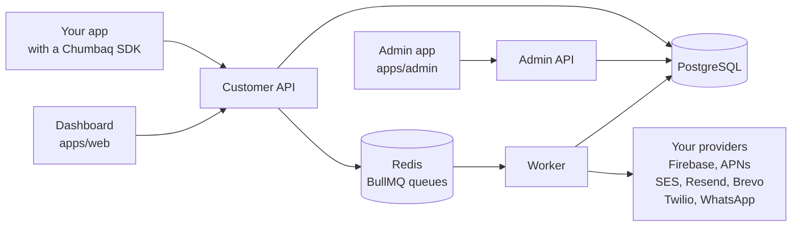

<div align="center">

<a href="https://chumbaq.com"></a>

# Chumbaq

### The open-source OneSignal alternative

Push notifications and in-app messages, plus email, SMS and WhatsApp through your own provider.<br>
Use our cloud, or self-host for free.

[**Website**](https://chumbaq.com) ·
[**Docs**](https://chumbaq.com/docs) ·
[**Start free**](https://app.chumbaq.com/register) ·
[**Self-host**](#self-hosting) ·
[**Chumbaq vs OneSignal**](https://chumbaq.com/compare/onesignal)

[](LICENSE)
[](https://www.npmjs.com/package/@chumbaq/sdk)
[](https://github.com/sohelyadav/chumbaq-ios-sdk)
[](https://central.sonatype.com/namespace/com.chumbaq)
[](https://pub.dev/packages/chumbaq)

</div>

## Why Chumbaq

- **Open source, all of it.** The API, the worker, the dashboard and the admin app are in this
  repo under AGPL-3.0. What we run on our cloud is what you can run on your own server.
- **Your own providers.** Push goes out through your own Firebase and APNs credentials, and
  email, SMS and WhatsApp through your own provider account. No campaign is sent from shared
  infrastructure.
- **Cloud or self-hosted.** [Chumbaq Cloud](https://app.chumbaq.com/register) is free up to
  2,500 monthly active users. Self-hosting is free, and the server setup and update scripts
  are in this repo.
- **Privacy built in.** Consent history, do-not-track, and per-person erasure and export are
  part of the platform, not an add-on.

## Features

| Feature | What it does |
|---|---|
| **Push notifications** | Scheduling, delivery in each person's timezone, quiet hours, frequency caps, A/B tests with a control group, templates, rich content and send-time optimisation. |
| **In-app messages** | Campaigns with delivery rules, shown by the SDK inside your app, with impressions and clicks reported back. |
| **Email** | Campaigns through your own Amazon SES, Resend or Brevo account, with bounce and complaint handling and one-click unsubscribe. |
| **SMS** | Campaigns through your own Twilio account, with STOP and START replies honoured. |
| **WhatsApp** | Approved-template campaigns through Meta, Twilio, Gupshup or Interakt. |
| **Audiences** | A visual segment builder over what people did and who they are. |
| **Journeys** | Start on an event or when someone enters a segment, then wait, branch, and send push, email, SMS or WhatsApp. |
| **Consent and privacy** | Opt-in per channel, suppression lists, do-not-track, and erasure and export for one person from the dashboard or the API. |
| **Teams** | Owner, admin and member roles, invitations, and an append-only activity log for every project. |
| **Integrations** | Outbound webhooks, API keys and Mixpanel cohort sync. |

> [!NOTE]
> Android and web push can be sent from the dashboard today. iOS push (APNs) is built, but has
> not yet been verified on a real iPhone.

## SDKs

Each SDK lives in its own repo and is licensed under Apache 2.0.

| Platform | Install | Repo |
|---|---|---|
| Web (JavaScript, TypeScript) | `npm install @chumbaq/sdk` | [chumbaq-js-sdk](https://github.com/sohelyadav/chumbaq-js-sdk) |
| iOS (Swift Package Manager) | `https://github.com/sohelyadav/chumbaq-ios-sdk` | [chumbaq-ios-sdk](https://github.com/sohelyadav/chumbaq-ios-sdk) |
| Android (Maven Central) | `implementation("com.chumbaq:chumbaq-core")` with the `com.chumbaq:chumbaq-bom` platform | [chumbaq-android-sdk](https://github.com/sohelyadav/chumbaq-android-sdk) |
| Flutter | `flutter pub add chumbaq` | [chumbaq-flutter-sdk](https://github.com/sohelyadav/chumbaq-flutter-sdk) |

## How it fits together



| Path | What it is |
|---|---|
| `apps/api` | NestJS API (customer API, admin API and background worker), TypeORM + Postgres, BullMQ + Redis |
| `apps/web` | Customer dashboard (React + Vite) |
| `apps/admin` | Operator admin app (React + Vite) |
| `packages/shared` | Types shared by the API and both apps |
| `scripts/` | Local dev runner and server setup/update scripts |
| `e2e/` | Playwright end-to-end tests |

## Run it locally

Needs Node 22+, Postgres and Redis.

```bash
git clone https://github.com/sohelyadav/chumbaq-platform.git
cd chumbaq-platform
npm install
cp .env.example .env      # then fill in the values it asks for
npm run build:shared
npm run dev:all           # API, worker, admin API, dashboard and admin app
```

`dev:all` checks Postgres, Redis and the ports before it starts anything, and says what is
missing. The dashboard is then at `https://localhost:5173` and the admin app at
`https://localhost:5174`, both with a self-signed certificate.

Without `PLATFORM_BREVO_API_KEY` and `PLATFORM_EMAIL_FROM` no account email goes out. When `NODE_ENV` is
set to `development` (as in `.env.example`), the API prints the sign-up link to its console instead, so you can finish
signing up. With `NODE_ENV` unset or set to anything else, it does not. Set the optional `PLATFORM_EMAIL_REPLY_TO` to
let people reply to account emails; without it they have no reply-to.

Optional demo data (drops and recreates the local database; refuses `NODE_ENV=production`):
`npm run seed`.

## Tests

```bash
npm run lint              # tsc --noEmit in every workspace
npm test                  # Jest unit tests (apps/api)
cd apps/api && npm run test:int   # integration tests, needs a Postgres test database
npm run test:e2e          # Playwright, see e2e/README.md
```

## Self-hosting

`scripts/deploy-setup.sh` sets up an Ubuntu 22.04+ server (Postgres, Redis, nginx, PM2,
certbot) and `scripts/deploy-update.sh` updates it. Read the top of each script for the
settings; set `APP_SERVER_NAME` and `ADMIN_SERVER_NAME` to your own hosts. The
[self-hosting guide](https://chumbaq.com/docs/self-host) walks through it.

Billing is optional and off by default: with it off there are no plans, no plan limits and
no billing routes, and the project and seat limits are `MAX_PROJECTS_PER_ACCOUNT` and
`MAX_SEATS_PER_ACCOUNT`.

<details>
<summary><b>Optional: charge for plans through Razorpay Subscriptions</b></summary>

<br>

Set all of:

| Variable | Notes |
|---|---|
| `RAZORPAY_KEY_ID` | `rzp_test_…` or `rzp_live_…`; billing stays off unless all three keys are set |
| `RAZORPAY_KEY_SECRET` | |
| `RAZORPAY_WEBHOOK_SECRET` | the secret of the Razorpay webhook pointed at the API |
| `BILLING_GRACE_DAYS` | days a halted subscription keeps its plan, 1 to 60, default 14 |
| `BILLING_TAX_RATE_BPS` | tax added to new prices, in basis points, 0 to 10000, default 0 (no tax); `1800` is 18% |
| `BILLING_ENABLED` | optional; `false` keeps billing off even with keys set |

Some of the three keys without the others stop the app at start-up, unless `BILLING_ENABLED=false`.

With billing on, every account without a paid plan is on the built-in `free` plan. It starts
with no limits of its own, so free accounts keep `MAX_PROJECTS_PER_ACCOUNT` and
`MAX_SEATS_PER_ACCOUNT` until you give the free plan its own; on any other plan an empty seat
or MAU limit means unlimited.

Plans live in the database, not in the code: staff create them and set their limits on the
admin app's Plans page, which works with billing off too, so limits can be ready before billing
is switched on. Prices are entered excluding tax, and a new price is stored with the rate
`BILLING_TAX_RATE_BPS` names when it is added (with the default 0, no tax: the price is what is
charged, and the dashboard shows no tax). For each price, first create a Razorpay plan that
charges exactly the amount the Add price dialog shows (the price plus that tax, in INR, every 1
month or 1 year), then paste its `plan_…` id: the admin API fetches the plan from Razorpay and
refuses it unless the amount, currency and period match. A new price replaces the current one
for new subscriptions; existing subscribers keep theirs, at the rate it was added with, so
changing `BILLING_TAX_RATE_BPS` affects only prices added afterwards.

Point a Razorpay webhook at `https://<your API host>/api/billing/webhooks/razorpay` with the
secret in `RAZORPAY_WEBHOOK_SECRET`, subscribed to `subscription.authenticated`, `.activated`,
`.charged`, `.pending`, `.halted`, `.cancelled`, `.completed` and `.updated`, `payment.failed`,
`invoice.paid`, `invoice.expired` and `refund.processed`. Subscription state changes only from
those verified webhooks and the server's own calls to Razorpay, so run the worker too: it sends
cancellations and catches up on missed events. Test with `rzp_test_` keys first, in a
production build of the dashboard (`npm run build:web`, then `npx vite preview` in `apps/web`):
its Content Security Policy applies only there, and Checkout must open and pay without the
browser console reporting a blocked request. Add any Razorpay origin it reports to the policy
in `apps/web/vite.config.ts`.

</details>

## Support

Found a bug or have a question? [Open an issue](https://github.com/sohelyadav/chumbaq-platform/issues).

## Security

Please report vulnerabilities privately to security@chumbaq.com rather than in a public issue.

## Licence

[GNU AGPL v3](LICENSE). If you run a modified version as a network service, you must offer
its source to its users. For a commercial licence or enterprise support, contact
hello@chumbaq.com.
